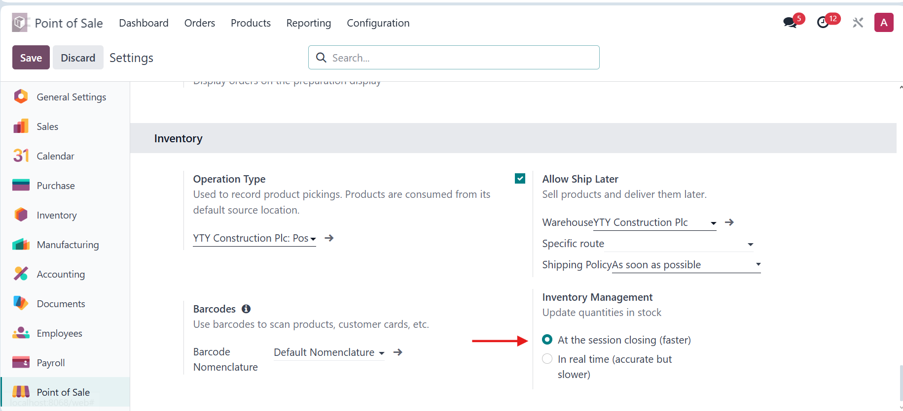
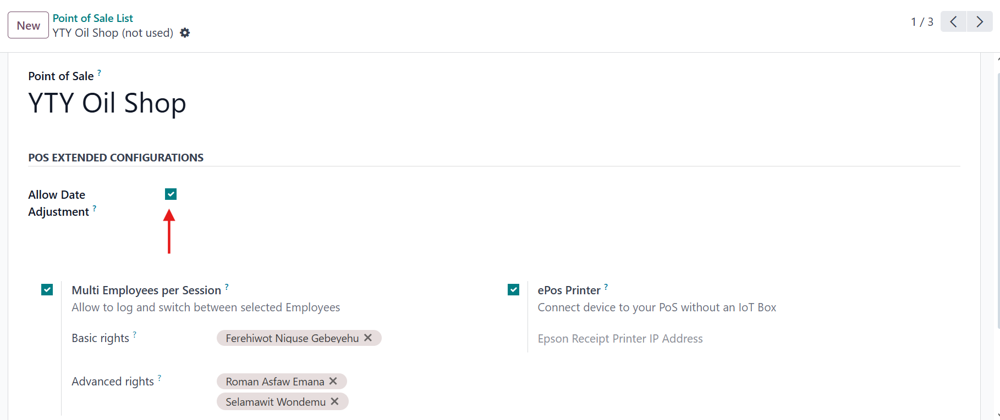
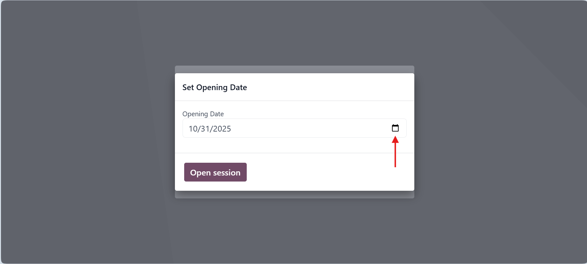
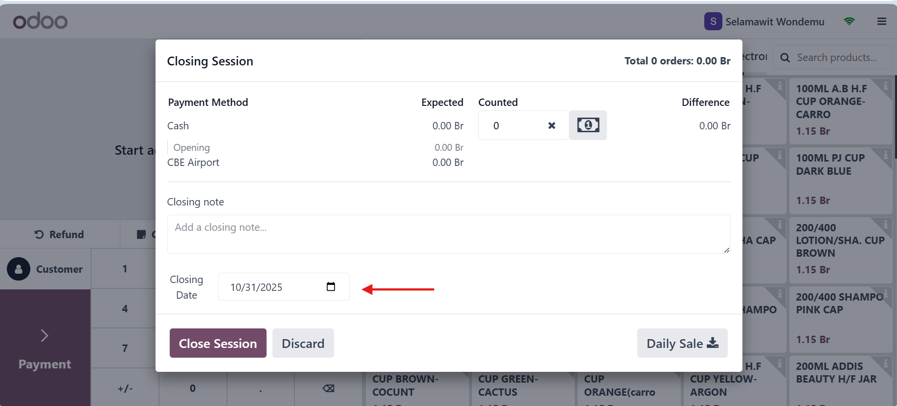

# POS Date Adjustment for Accounting and Stock

## Overview
This module allows users to **adjust the opening and closing dates** of Point of Sale (POS) sessions in Odoo.  
When the date is corrected, all related **accounting entries** and **inventory transactions** are automatically updated to match the session’s new closing date.

It is especially useful when a user wants to enter **backlog sales data** at a later date.

Without this module, such mistakes cause inconsistencies between **sales**, **accounting**, and **stock reports**.  
With this module, your POS data stays perfectly synchronized with accounting and inventory — even for late or backdated sessions.

---

## Key Features
- 🕒 Adjust **POS opening and closing dates** manually  
- 🔄 Automatically **update all related accounting and inventory entries**  
- 📊 Ensures consistency across **sales, accounting, and stock reports**  
- 🧾 Helps correct **backlog or late-closing sessions**  
- 👨‍💼 Simple and intuitive interface integrated with the POS session form  
- ✅ Prevents manual journal or inventory corrections

---

## Example Use Case
You realize that yesterday’s POS session wasn’t closed on time — it automatically closed this morning.  
Now your sales, accounting, and stock entries show transactions for the wrong date.

With this module:
1. Open the affected POS session. 
2. Set the opening Date
3. After Adding the orders at closing session set also the closing Date. 
4. The module automatically adjusts all related accounting and stock moves to that new date.

✅ Result: consistent reports and accurate daily records.

---

## Compatibility
- Odoo Versions: **17.0**  
- Editions: **Enterprise**

---

## Installation
1. Copy the module folder into your Odoo `addons` directory.  
2. Update your Apps list in Odoo.  
3. Search for **POS Date Adjustment for Accounting and Stock** and install it.

---

## Support & Contact
📧 **Email:** dagemalemayehu123@gmail.com 
🌐 **Website:** mailto:dagemalemayehu123@gmail.com
📞 **Phone:** +251941623292  

---

## License
This module is licensed under the **OPL-1** License.

---

## 🖼️ Configuration Screenshots

### 1. First set the inventory management must be set to At session Closing.

### 2. Then allow date adjustment must be set ( for both the above settings the session must be closed to change their value).

### 3. After configuration is done on opening session the system asks for opening Date( defaults to today ).

### 4. And After you added all the orders in the system close the session and at the bottom it asks for a closing date ( defaults to the opening date ).

### 5. After closing the session the system automatically sets the Order Date, Stock Picking Date, Stock Move Date, POS Journal Date, Payment Dates, Stock Valuation date and Cash Difference dates to the session closing date.